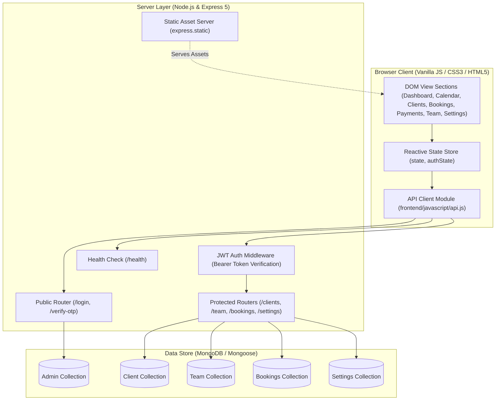
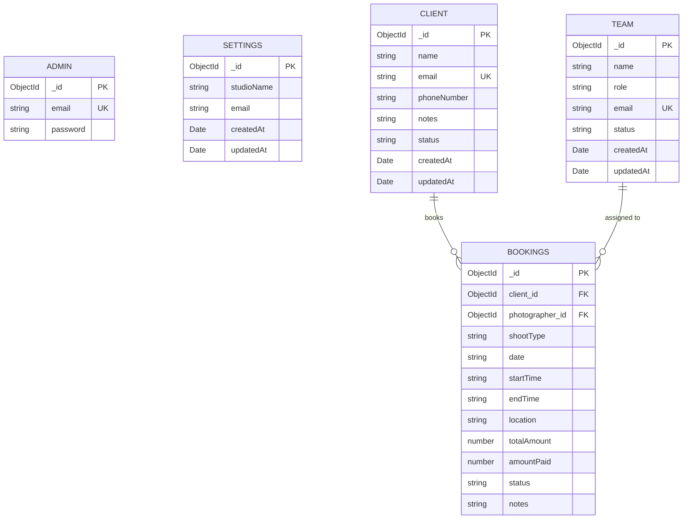

# StudioOS

A centralized studio operations platform for photography businesses to manage clients, bookings, team scheduling, payments, and studio configurations.

---

## Overview

Photo studios often manage their daily operations through fragmented tools: spreadsheets for client lists, messaging apps for photographer scheduling, paper calendars or generic calendar apps for shoots, and manual notebooks for payment tracking. This fragmentation leads to double-booking errors, untracked receivables, and administrative overhead.

**StudioOS** consolidates these core operations into a single operational interface. Studio owners can manage the complete lifecycle of a photo session—from initial client intake and photographer assignment to schedule conflict verification, payment tracking, and studio branding.

The application is structured around a software-as-a-service (SaaS) operational model where studio operations are isolated per business. It provides a lightweight, responsive interface backed by a Node.js REST API and MongoDB document store.

---

## Features

### Dashboard
- **Operational Metrics**: Real-time KPI cards displaying today's shoot count, active client volume, pending payment balance, and current month's projected revenue.
- **Today's Schedule**: Chronological listing of shoots scheduled for the current date, including time window, client name, shoot category, assigned photographer, and location.
- **Upcoming Bookings**: Overview of the next five upcoming confirmed or pending sessions.
- **Active Roster**: Quick-glance list of active team members and their designated studio roles.

### Calendar Engine
- **Custom Multi-View Engine**: Purpose-built grid calendar implemented in vanilla JavaScript without heavy external calendar dependencies.
- **View Modes**:
  - **Month View**: Standard 42-cell calendar grid showing day numbers, current-month demarcation, and color-coded booking badges. Clicking an empty date opens the booking modal with the date pre-filled; clicking a booking badge opens the edit modal.
  - **Week View**: Seven-day columnar view focusing on weekly photographer distribution.
  - **Day View**: Single-day chronological schedule view.
- **Navigation Controls**: Previous/Next month navigation and a "Today" quick-return action.

### Client Management
- **Client Directory**: Centralized directory displaying client name, contact email, phone number, and administrative notes.
- **Search & Filtering**: Client-side filtering across names, emails, phone numbers, and notes.
- **Inline Client Creation**: Ability to add a new client directly inside the booking creation modal without navigating away from the scheduling workflow.
- **Lifecycle & Soft Deletion**: Clients can be created, updated, or soft-deleted (`status: "inactive"`). If a deleted client's email is re-submitted, the record is automatically reactivated.

### Bookings & Scheduling
- **Session Records**: Complete shoot details including date, start/end time, location, shoot category (*Portrait*, *Wedding*, *Event*, *Commercial*, *Family*, *Real Estate*), financial balance, and notes.
- **Team Assignment**: Direct assignment of active team members to specific shoots.
- **Schedule Conflict Detection**: Client-side conflict detection engine (`checkConflict`) that evaluates prospective booking intervals against existing non-cancelled bookings for the assigned photographer on that date, rendering an immediate visual warning if an overlap occurs.
- **Relational Population**: Backend populates client and photographer references via Mongoose references (`populate`).
- **Cancellation Workflow**: Soft cancellation (`status: "Cancelled"`) preserving historical records while removing the booking from active scheduling and revenue metrics.

### Payment Tracking
- **Balance Ledger**: Aggregates total contract value (`totalAmount`) and received deposits/payments (`amountPaid`) per booking.
- **Financial Status Metrics**: Global counters displaying cumulative studio revenue, total settled payments, and outstanding receivables.
- **Invoice Reference Generation**: Formatted invoice identifiers (`INV-<PREFIX>`) for payment tracking and balance settlement verification.

### Team Management
- **Staff Records**: Role-based team directory tracking staff members across standard studio roles (*Lead Photographer*, *Associate Photographer*, *Assistant*, *Editor*).
- **Roster Controls**: Team members can be added, updated, or deactivated (`status: "Inactive"`). Re-adding an existing email address restores the record to active status.

### Studio Settings
- **Studio Profile**: Configuration for the studio's public brand name and administrative contact email.
- **Dynamic Header Branding**: Updates in studio settings immediately reflect across dashboard banners, document titles, and application headers.

---

## Technology Stack

| Layer | Technologies | Purpose |
| :--- | :--- | :--- |
| **Frontend** | Vanilla HTML5, CSS3, JavaScript (ES6+ Modules) | Lightweight, dependency-free client application using native DOM APIs and Flexbox/CSS Grid. |
| **Typography & Icons** | Inter (Google Fonts), Remix Icon (CDN) | Clean UI typography and interface iconography. |
| **Backend Runtime** | Node.js (v18+) | Server-side execution environment using native ES module syntax (`"type": "module"`). |
| **Web Framework** | Express.js (v5.3.0) | Routing, HTTP middleware, and API endpoint orchestration. |
| **Database** | MongoDB with Mongoose (v9.11.4) | Document schema definitions, validation, and object modeling. |
| **Authentication** | JSON Web Tokens (`jsonwebtoken`), `bcrypt` | Stateless bearer token authentication and salt-hashed password storage. |
| **Environment & Config** | `dotenv` | Environment variable parsing and isolation. |
| **Deployment** | Render, Docker/Native Node Web Service | Cloud hosting with automated health checks (`/health`) and Blueprint support (`render.yaml`). |

---

## Project Architecture

StudioOS uses a decoupled single-page application (SPA) model served through an Express server that acts as both the static file host and the JSON REST API provider.



### Communication Flow
1. **Asset Delivery**: Upon receiving a root `GET /` request, Express serves the frontend bundle (`index.html`, `styles.css`, `javascript/app.js`).
2. **API Requests**: The client-side `api.js` wrapper handles requests using native `fetch`. In production, requests use relative paths (`""`), automatically resolving to the host origin. In local split-server development (e.g., Live Server on port 5500), it routes to `http://localhost:4056`.
3. **Authentication**: Authenticated API calls pass a standard HTTP header: `Authorization: Bearer <JWT>`.
4. **Data Persistence**: Route handlers validate inputs, perform Mongoose queries, and return standardized JSON responses.

---

## Multi-Tenant Architecture

### Conceptual Design
StudioOS is conceptually designed as a multi-tenant SaaS application where each photo studio operates as an isolated tenant:
- Each studio is represented by a unique `studioId`.
- An authenticated studio owner has access only to data associated with their `studioId`.
- All operational documents (`Client`, `Bookings`, `Team`, `Settings`) are designed to be partitioned by `studioId`.
- The permission model is designed around an **Owner** role with full operational control over their studio.

### Current Implementation State (Technical Assessment)
The current codebase functions as a **single-tenant prototype**:
- **Authentication**: Authentication is handled by a single `Admin` record provisioned on startup via `ADMIN_EMAIL` and `ADMIN_PASSWORD` defined in `.env`.
- **Schema Partitioning**: The current Mongoose models (`Client`, `Team`, `Bookings`, `Settings`) do not currently have a `studioId` foreign key field. Unique indexes on `Client.email` and `Team.email` are currently global.
- **Query Scoping**: Database queries (`find()`, `findOne()`, etc.) return records across the active database without tenant ID scoping.
- **Settings**: The `Settings` collection operates as a global singleton document.

### Multi-Tenant Migration Roadmap
To transition the current prototype into a fully enforced multi-tenant architecture, the following updates are required:
1. **Studio Model**: Implement a dedicated `Studio` schema (e.g., `name`, `subdomain`, `ownerId`, `subscriptionStatus`).
2. **Schema Scoping**: Add an indexed `studioId` field referencing `Studio` across all operational schemas (`Client`, `Team`, `Bookings`, `Settings`).
3. **Compound Indexes**: Convert unique email indexes to compound indexes:
   ```javascript
   clientSchema.index({ studioId: 1, email: 1 }, { unique: true });
   ```
4. **Token Context**: Embed `studioId` within the signed JWT payload upon login.
5. **Tenant Scoping Middleware**: Enhance `authMiddleware` to attach `req.studioId = decoded.studioId`, and automatically append `{ studioId: req.studioId }` to all query and mutation filters.

---

## Project Structure

```text
StudioOS/
├── backend/
│   ├── config/
│   │   └── connectDB.js          # MongoDB connection handler & initial admin seeding
│   ├── controllers/
│   │   ├── private/
│   │   │   ├── bookings.js       # Booking CRUD, population, and soft cancellation
│   │   │   ├── client.js         # Client directory, validation, and soft deletion
│   │   │   ├── settings.js       # Studio profile settings management
│   │   │   └── team.js           # Staff roster management & status toggle
│   │   └── public/
│   │       └── login.js          # Owner authentication & OTP verification endpoints
│   ├── middleware/
│   │   └── auth.js               # JWT bearer token verification middleware
│   ├── models/
│   │   ├── Admin.js              # Administrative user credentials schema
│   │   ├── Bookings.js           # Shoot sessions, financial balances, & references
│   │   ├── Client.js             # Client contact records and active state
│   │   ├── Settings.js           # Studio name and email configuration
│   │   └── Team.js               # Photographer & staff directory schema
│   ├── utils/
│   │   └── token.js              # Token generation helper
│   └── server.js                 # Express server configuration, middleware, and routing
├── frontend/
│   ├── javascript/
│   │   ├── api.js                # API client with token injection & base URL resolution
│   │   └── app.js                # State management, DOM rendering, calendar, & modals
│   ├── index.html                # Single-page interface markup & modal dialogs
│   └── styles.css                # CSS design system, typography, & responsive layouts
├── .env.example                  # Environment variable reference template
├── .gitignore                    # Git tracking ignore rules
├── package.json                  # Node.js project manifest & scripts
├── render.yaml                   # Render Blueprint Infrastructure-as-Code specification
└── README.md                     # Project documentation
```

---

## Getting Started

### Prerequisites
- **Node.js**: v18.0.0 or higher
- **npm**: v9.0.0 or higher
- **MongoDB**: A running local MongoDB instance or a [MongoDB Atlas](https://www.mongodb.com/atlas) cluster connection string.

### 1. Clone the Repository
```bash
git clone https://github.com/<your-username>/StudioOS.git
cd StudioOS
```

### 2. Install Dependencies
```bash
npm install
```

### 3. Configure Environment Variables
Copy the environment template and define your configuration:
```bash
cp .env.example .env
```
Edit `.env` with your actual settings:
```ini
PORT=4056
MONGODB_URI=mongodb+srv://<username>:<password>@cluster0.xxxxx.mongodb.net/StudioOS?retryWrites=true&w=majority
ADMIN_EMAIL=admin@yourstudio.com
ADMIN_PASSWORD=your_secure_password
SECRET_KEY=your_jwt_signing_secret_key
ALLOWED_ORIGINS=*
```

### 4. Run the Application
Start the unified backend and frontend server:
```bash
npm start
```

### 5. Access the Interface
Open your browser and navigate to:
```
http://localhost:4056
```
Log in using the credentials configured in `ADMIN_EMAIL` and `ADMIN_PASSWORD`.

> **Development Note**: If you run the frontend via a separate development server (such as VS Code Live Server on `http://localhost:5500`), the client API adapter will automatically detect the local dev port and route API requests to `http://localhost:4056`.

---

## Environment Variables

| Variable | Required | Default | Description |
| :--- | :---: | :---: | :--- |
| `PORT` | No | `4056` | The TCP port the Express server binds to. In production (e.g. Render), this is injected automatically. |
| `MONGODB_URI` | **Yes** | — | MongoDB connection string (local URI or MongoDB Atlas SRV URI). |
| `ADMIN_EMAIL` | **Yes** | — | Email address for the initial studio owner account. Seeded on boot. |
| `ADMIN_PASSWORD` | **Yes** | — | Plaintext password for initial seeding; hashed via `bcrypt` upon insertion. |
| `SECRET_KEY` | **Yes** | — | Cryptographic secret used by `jsonwebtoken` to sign and verify session tokens. |
| `ALLOWED_ORIGINS`| No | `*` | Comma-separated list of allowed CORS origins or `*` to allow all origins. |

---

## API Documentation

All protected endpoints require the HTTP header:  
`Authorization: Bearer <token>`

### Health & Monitoring
| Method | Endpoint | Auth | Description |
| :--- | :--- | :---: | :--- |
| `GET` | `/health` | None | Returns server health status `{ status: "ok", msg: "This api is up and running" }`. Used by deployment health probes. |

### Authentication
| Method | Endpoint | Auth | Request Body | Response (200 / 201) |
| :--- | :--- | :---: | :--- | :--- |
| `POST` | `/login` | None | `{ "email": "...", "password": "..." }` | `{ "message": "Login successful", "token": "...", "admin": { "email": "..." } }` |
| `POST` | `/verify-otp` | None | `{ "email": "...", "otp": "..." }` | `{ "message": "OTP verified (temporary placeholder)", "token": "..." }` |

### Clients Module
| Method | Endpoint | Auth | Request Body | Description |
| :--- | :--- | :---: | :--- | :--- |
| `GET` | `/clients/api/get-clients` | Yes | None | Retrieves all active clients (`status: "active"`). |
| `POST` | `/clients/api/create-client` | Yes | `{ "name": "...", "email": "...", "phone": "...", "notes": "..." }` | Creates a new client record, or reactivates an inactive client matching the email. |
| `PATCH` | `/clients/api/edit-client-details/:id` | Yes | `{ "name": "...", "email": "...", "phone": "...", "notes": "..." }` | Updates details for an existing active client. |
| `PATCH` | `/clients/api/delete-client/:id` | Yes | None | Soft-deletes client by setting `status = "inactive"`. |

### Team Module
| Method | Endpoint | Auth | Request Body | Description |
| :--- | :--- | :---: | :--- | :--- |
| `GET` | `/team/api/get-all-members` | Yes | None | Retrieves all active team members (`status: "Active"`). |
| `POST` | `/team/api/add-member` | Yes | `{ "name": "...", "role": "...", "email": "..." }` | Creates a new staff member or reactivates an inactive record. |
| `PATCH` | `/team/api/update-details/:id` | Yes | `{ "name": "...", "role": "...", "email": "..." }` | Updates team member details. |
| `PATCH` | `/team/api/delete-member/:id` | Yes | None | Soft-deletes a team member by setting `status = "Inactive"`. |

### Bookings Module
| Method | Endpoint | Auth | Request Body | Description |
| :--- | :--- | :---: | :--- | :--- |
| `GET` | `/bookings/api/get-all-bookings` | Yes | None | Retrieves all bookings with populated `client_id` and `photographer_id` references. |
| `POST` | `/bookings/api/create-booking` | Yes | `{ "clientId": "...", "photographerId": "...", "shootType": "...", "date": "YYYY-MM-DD", "startTime": "HH:MM", "endTime": "HH:MM", "location": "...", "totalAmount": 500, "amountPaid": 200, "status": "Confirmed", "notes": "..." }` | Creates a new booking session record. |
| `PATCH` | `/bookings/api/update-booking/:id` | Yes | Partial booking fields | Modifies existing booking details and financial balances. |
| `PATCH` | `/bookings/api/delete-booking/:id` | Yes | None | Sets booking `status` to `"Cancelled"`. |

### Settings Module
| Method | Endpoint | Auth | Request Body | Description |
| :--- | :--- | :---: | :--- | :--- |
| `GET` | `/settings/api/settings` | Yes | None | Fetches the current studio configuration. Initializes defaults if empty. |
| `PATCH` | `/settings/api/settings` | Yes | `{ "studioName": "...", "email": "..." }` | Upserts the studio name and contact email. |

---

## Database Design



### Model Specifications

#### 1. Admin (`backend/models/Admin.js`)
- Stores studio owner login credentials.
- `email`: `String`, unique, lowercase, trimmed.
- `password`: `String`, stored as a salted `bcrypt` hash.

#### 2. Client (`backend/models/Client.js`)
- `name`: `String`, maximum 50 characters, trimmed.
- `email`: `String`, unique, lowercase, trimmed.
- `phoneNumber`: `String`, required contact number.
- `notes`: `String`, optional background notes.
- `status`: `String`, enum: `["active", "inactive"]`, default: `"active"`.

#### 3. Team (`backend/models/Team.js`)
- `name`: `String`, staff member name.
- `role`: `String`, enum: `["Lead Photographer", "Associate Photographer", "Assistant", "Editor"]`.
- `email`: `String`, unique staff email address.
- `status`: `String`, enum: `["Active", "Inactive"]`, default: `"Active"`.

#### 4. Bookings (`backend/models/Bookings.js`)
- `client_id`: `ObjectId`, foreign key referencing `Client`.
- `photographer_id`: `ObjectId`, foreign key referencing `Team`.
- `shootType`: `String`, enum: `["Portrait", "Wedding", "Event", "Commercial", "Family", "Real Estate"]`.
- `date`: `String` (formatted `YYYY-MM-DD`).
- `startTime` / `endTime`: `String` (formatted `HH:mm`).
- `location`: `String`, shoot address or studio room.
- `totalAmount`: `Number`, total contracted fee (default `0`, minimum `0`).
- `amountPaid`: `Number`, settled payment to date (default `0`, minimum `0`).
- `status`: `String`, enum: `["Confirmed", "Pending", "Cancelled"]`.
- `notes`: `String`, administrative session notes.

#### 5. Settings (`backend/models/Settings.js`)
- `studioName`: `String`, display name for the studio.
- `email`: `String`, official studio correspondence email.

---

## Application Workflow

1. **Owner Authentication**:
   - The user opens the application and is presented with the authentication overlay.
   - The user submits their administrative email and password to `POST /login`.
   - The server verifies credentials against the `Admin` collection using `bcrypt.compare`.
   - Upon verification, the two-step verification UI is displayed with a 6-digit confirmation code.
   - Submitting the code to `POST /verify-otp` returns a signed JWT, which is cached in memory for subsequent API requests.
2. **Dashboard Initialization**:
   - The frontend triggers parallel requests via `Promise.all` to fetch clients, team members, bookings, and settings.
   - The dashboard calculates current-day sessions, active client counts, pending receivables, and monthly revenue.
3. **Client Intake**:
   - Clients are added either via the **Clients** tab or inline inside the booking dialog.
4. **Session Scheduling & Conflict Avoidance**:
   - When creating or editing a booking, selecting a photographer, date, and time triggers `checkConflict()`.
   - If the assigned photographer already has a booking overlapping that time window, a warning appears in the dialog.
5. **Calendar Navigation**:
   - Bookings appear automatically on the visual calendar. Users can toggle between Month, Week, and Day views.
6. **Financial Settlement**:
   - The **Payments** section aggregates contractual totals against payments collected.
   - Bookings with unpaid balances reflect a "Pending" status badge, allowing studio owners to monitor outstanding accounts.

---

## Security and Data Isolation

- **Password Hashing**: Administrative passwords are encrypted using `bcrypt` with a work factor of 10 rounds prior to database insertion.
- **Stateless Authorization**: Private routes are guarded by `authMiddleware`, verifying the signature and expiration of bearer tokens against `SECRET_KEY`.
- **Injection Mitigation**: Queries use Mongoose schema definitions and typed ObjectIDs, mitigating typical NoSQL query injection vulnerabilities.
- **Input Sanitization**: User-rendered strings in the DOM pass through an `escapeHTML` entity-encoding filter to prevent Cross-Site Scripting (XSS).
- **Current Limitations**:
  - OTP verification currently functions as an architectural placeholder and does not send emails via SMTP/SMS.
  - Multi-tenant query isolation is not yet enforced at the database layer; queries operate against a shared global namespace.

---

## Deployment

The repository includes a ready-to-use Render Blueprint configuration ([`render.yaml`](file:///home/waheed/StudioOS/render.yaml)) configured for deployment as a unified Node.js Web Service.

### Deployment Instructions (Render)

1. **Repository Setup**: Ensure your code is pushed to your Git repository.
2. **Create Blueprint**: In the [Render Dashboard](https://dashboard.render.com), select **New +** > **Blueprint** and connect the repository.
3. **Environment Parameters**:
   - `MONGODB_URI`: Provide your MongoDB Atlas connection string.
   - `ADMIN_EMAIL`: Set your production administrative email.
   - `ADMIN_PASSWORD`: Set your production administrative password.
   - *(Note: `SECRET_KEY` is automatically generated by Render as a cryptographically secure random string).*
4. **Network Access**:
   > **Important**: In your MongoDB Atlas dashboard, navigate to **Network Access** and add `0.0.0.0/0` (Allow Access from Anywhere) to the IP access list. Render instances use dynamic outbound IPs.
5. **Health Checks**: Render automatically monitors service health using the `/health` endpoint.

---

## Future Improvements

- **Full Multi-Tenant Schema Isolation**: Introduce `studioId` across all collections with compound indexing and middleware-level query scoping.
- **Live Two-Factor Delivery**: Integrate an email transport provider (e.g., SendGrid, AWS SES) or SMS gateway (e.g., Twilio) to deliver genuine time-based one-time passcodes (TOTP).
- **Automated Client Notification**: Automated booking confirmations and calendar invites (`.ics` / Google Calendar sync) sent directly to clients.
- **Integrated Payment Processing**: Direct payment collection via Stripe or Square webhooks to replace manual balance entry with automated payment tracking.
- **Client Portal**: A read-only external client portal allowing clients to view session details, sign agreements, and download proof galleries.
